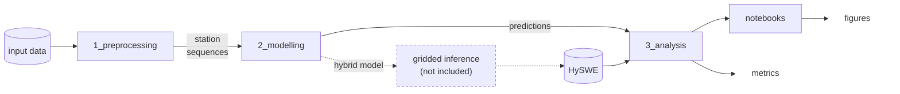

# Hybrid LSTM for daily Northern Hemisphere snow water equivalent

Code to train and evaluate the LSTM models of the paper *Daily 1 km Northern Hemisphere snow water equivalent reconstruction for 1980–2020 based on hybrid machine learning* (Pomarol Moya et al., in preparation).

An LSTM model was used to predict daily snow water equivalent (SWE) from meteorological (CHELSA) and topographic (EarthEnv) predictors, trained on in situ SWE from the NH-SWE station dataset. Two variants were compared:

- **Hybrid:** the predictors plus the coarse process-based ERA5-Land SWE;
- **Data-driven LSTM:** the same predictors without ERA5-Land.

The hybrid model was used to produce **HySWE**, a daily 30″ (~1 km) SWE dataset for 1980–2020: https://doi.org/10.24416/UU01-9COE1V. The code that runs the model over the grid is not part of this repository, and can be found at: https://github.com/computationalgeography/raster_to_pytorch.

## Quick start

```bash
conda env create -f environment.yml && conda activate snow_nh
cp src/common/local_paths.example.py src/common/local_paths.py   # then set the paths in it
python -m unittest discover -s src/tests -v                      # synthetic data only, no downloads
```

`local_paths.py` (ignored by git) holds only the folders of your machine:

- `BASE_PATH`: the project folder, containing `data/` and `results/`;
- `CHELSA_PATH` and `ERA5LAND_PATH`: the large external datasets;
- `SOURCE_PATHS`: the daily gridded SWE maps compared in the analyses.

Everything else is at a fixed place under `BASE_PATH` (see [Data](#data)).

For a quick end-to-end check on 11 Pyrenees stations, set `TEST_MODE = True` in `src/common/config.py` and run the preprocessing and `main.py` as below. Every file written or read then gets the prefix `test_`, so no real output is overwritten.

## Reproducing the paper



Run every command from the repository root with the `snow_nh` environment active. The job scripts in `jobs/` are for SLURM: add a `--partition` line for your cluster and `mkdir -p out` before a direct `sbatch`.

### 1. Preprocessing

| Step | Command | Writes (under `BASE_PATH/data`) |
|---|---|---|
| Study-area mask | `python src/1_preprocessing/create_validity_mask.py` | `valid_swe_regression_flags.nc`, `analysis_mask_no10s.tif` |
| Stratum weights | `python src/1_preprocessing/compute_stratum_weights.py` | `CLASS_ELEV_WEIGHTS.csv` |
| Station attributes | `python src/1_preprocessing/extract_station_attributes.py` | `SnowClass` in `STATION_METADATA.csv`, `topo_data/NH_TOPO.csv` |
| Meteorology at the stations | `python src/1_preprocessing/extract_meteo_timeseries.py` | `meteo_data/NH_METEO_ID_<id>.csv` |
| ERA5-Land SWE at the stations | `python src/1_preprocessing/extract_era5_swe_timeseries.py` | `swe_data/ERA5_LAND/NH_ERA5_SWE_ID_<id>.csv` |
| Training sequences | `python src/1_preprocessing/save_training_sequences.py` | `temp/static_predictors.csv`, `temp/dynamic_predictors_ID_<id>.csv` |

Run the two extraction scripts one after the other, never at the same time: both write the matched grid coordinates into `STATION_METADATA.csv`. The first three scripts accept `--out-dir DIR` to write elsewhere.

### 2. Final models (Tables 2–5)

For each variant, set `HYBRID_MODE` in `src/common/config.py`, set `HPARAMS_BASE` in `jobs/run_seeds_parallel.sh` to the paper's hyperparameters (Table 2), and submit:

| Variant | `HYBRID_MODE` | `HPARAMS_BASE` | Command |
|---|---|---|---|
| hybrid | `True` | `{"learning_rate": 0.0001, "optimizer_name": "RMSprop", "n_epochs": 200, "batch_size": 32, "hidden_size": 128, "dropout": 0.0}` | `bash jobs/run_seeds_parallel.sh hybrid` |
| data-driven | `False` | `{"learning_rate": 0.0005, "optimizer_name": "RMSprop", "n_epochs": 200, "batch_size": 32, "hidden_size": [32, 2], "dropout": 0.0}` | `bash jobs/run_seeds_parallel.sh lstm` |

Each call runs seeds 1–5 in parallel in one job (24 CPUs, 120 h limit) on the `full` station set, writing to `results/train_seeded_runs/<name>_seed<s>/`. The job reads `config.py` when it **starts**, so don't change `HYBRID_MODE` until the first job is running.

The paper uses, per variant, the seed with the lowest validation loss (the minimum of `val_loss` in `lstm_epoch_losses.csv`). Copy those two run folders to `results/final_model_comparison/hybrid` and `.../lstm`. Then create `results/final_model_comparison/era5_land/` holding only a copy of `station_splits.csv`: this folder scores ERA5-Land itself as the baseline.

Station metrics (Tables 3–5):

```bash
python src/3_analysis/compute_metrics.py
```

It scores every folder in `results/final_model_comparison/` and writes `evaluation_metrics_thr_<threshold>_<weighted|unweighted>.csv` there. The settings are at the top of the script: `threshold` (predictions below it are set to 0; 5 mm in the paper) and `apply_weights` (weighting by snow class × elevation stratum, Sect. 2.3.2).

### 3. Gridded analyses (Figs. 3, 6–9, Table 6)

```bash
mkdir -p out && sbatch jobs/run_dataset_analysis_array.sh
```

This runs 8 array tasks: ERA5-Land and HySWE × {long-term trends, day-of-year SWE, NorSWE validation, average peak SWE}. They read the daily maps in `SOURCE_PATHS` and write to `results/temp/` and `results/norswe_<source>_metrics.csv`. Each script can also run alone with `--source era5_land|hybrid`.

### 4. Figures

| Notebook | Paper |
|---|---|
| `notebooks/figures_station_evaluation.ipynb` | Figs. 2, 4, 5 |
| `notebooks/figures_gridded_dataset.ipynb` | Figs. 3, 6–9, Table 6 |

Start Jupyter from `notebooks/`. Each notebook lists its input files at the top.

### Hyperparameter search and predictor selection (Appendices A and B)

- **Hyperparameter grid** (Appendix B): `bash jobs/run_hp_parallel.sh <name>` runs the 240 combinations of Table B1 for the current `HYBRID_MODE`, as a SLURM array of 12 runs per task. It uses the `tune` station set and writes to `results/hp_tuning_<name>/<run_id>/`. Run it once per variant.
- **Predictor experiments** (Appendix A): `sbatch jobs/run_predictors_sequential.sh` runs, one after the other, each config file listed in `experiment_configs/run_order.txt`. Each file is a complete `config.py` with different `DYN_VARS`/`STATIC_VARS`. The configs of the paper are not included. The job **overwrites `src/common/config.py` and `data/temp`**: restore both afterwards. The land-cover predictors also need `aggregate_land_cover.py` and then `extract_station_attributes.py` again.

### Single runs

```bash
python src/2_modelling/main.py --station-set subset --results-subdir my_run \
  --hparams '{"learning_rate": 0.001, "n_epochs": 50}'
```

| Option | Meaning |
|---|---|
| `--hparams` | JSON with any of `batch_size`, `hidden_size` (int or `[size, layers]`), `learning_rate`, `optimizer_name` (`Adam`, `RMSprop`, `SGD`), `n_epochs`, `chunk_size`, `patience`, `min_delta`, `dropout`, `max_training_hours`. Missing keys take the defaults in `src/common/shared.py`; unknown keys are an error. |
| `--station-set` | which stations to use (see the table below) |
| `--train-seed` | random seed (default 10) |
| `--results-subdir` | the run folder under `results/` |

On a cluster, `sbatch jobs/single_modelling_run.sh <main.py arguments>` runs it on one GPU.

| `--station-set` | train | validation (early stopping) | evaluation |
|---|---|---|---|
| `full` (final runs) | 70 % | 10 % | the held-out 20 % |
| `tune` (HP search) | 50 % | 10 % | another 20 % |
| `subset` (quick runs, Appendix A) | ~100 of the `tune` training stations | 10 % | the same 20 % as `tune` |

The split is stratified by elevation band × snow class and is the same for every seed.

## Data

No data are included. Download each dataset from its provider, under its terms of use:

| Dataset | Used for | Reference | Expected location |
|---|---|---|---|
| NH-SWE station SWE and metadata | targets | Fontrodona-Bach et al. (2023), https://doi.org/10.5281/zenodo.7515603 | `data/swe_data/NH_SWE/files/`, `data/STATION_METADATA.csv` |
| CHELSA-daily V2.1 (`pr`, `tas`, `rsds`; `tasmin`, `tasmax` for Appendix A) | dynamic predictors | Karger (2025), https://doi.org/10.16904/envidat.687 | `CHELSA_PATH/<var>/CHELSA_<var>_DD_MM_YYYY_V.2.1.tif` |
| EarthEnv topography, 1 km, GMTED2010-based | static predictors | Amatulli et al. (2018), https://doi.org/10.1594/PANGAEA.867115 | `data/topo_data/Amatulli_2016/*_GMTED*.tif` |
| ERA5-Land daily mean SWE (`sd`), 1979–2020 | hybrid predictor | https://doi.org/10.24381/CDS.E9C9C792 | `ERA5LAND_PATH/sd/sd_ERA5-Land_<year>0101-<year>1231.nc` |
| Global Seasonal-Snow Classification | stratification, mask | Liston and Sturm (2021), https://doi.org/10.5067/99FTCYYYLAQ0 | `data/swe_data/SnowClass_GL_01km_30.0arcsec_2021_v01.0.nc` |
| MODIS snow-cover climatology (NSIDC-0791) | mask | Johnston et al. (2024), https://doi.org/10.5067/9R1AM6NNZLTV | `data/swe_data/MODIS/NSIDC-0791_SSC_0.01Deg_WY2001-2023_V01.0.nc` |
| NorSWE v3.0 | independent validation | Mortimer and Vionnet (2025), https://doi.org/10.5281/zenodo.15263370 | `data/swe_data/NorSWE/NorSWE-NorEEN_1979-2021_v3.nc` |
| GMBA Mountain Inventory v2.0 (standard, 300) | mountain regions | Snethlage et al. (2022), https://doi.org/10.1038/s41597-022-01256-y | `data/GMBA_Inventory_v2.0_standard_300/` |
| GLC_FCS30D land cover, 30 m (Appendix A only) | land-cover predictors | Zhang et al. (2024), https://doi.org/10.5281/zenodo.8239305 | `data/land_cover_data/decompressed/` |
| ERA5-Land daily maps, conservatively regridded to 30″ (`sd_ERA5-Land_DD_MM_YYYY.tif`) | gridded analyses, mask | derived from ERA5-Land | `SOURCE_PATHS['era5_land']` |
| HySWE (`SWE_DD_MM_YYYY.tif`) | gridded analyses | https://doi.org/10.24416/UU01-9COE1V | `SOURCE_PATHS['hybrid']` |

The figure notebooks also download the Natural Earth land polygons.

## Configuration

`src/common/config.py` holds the experiment settings:

| Setting | Meaning |
|---|---|
| `HYBRID_MODE` | `True`: hybrid model (feeds ERA5-Land SWE); `False`: data-driven LSTM. No new preprocessing needed. |
| `DYN_VARS`, `STATIC_VARS` | the predictors. After a change, re-run `save_training_sequences.py`. `'swe'` must stay in `DYN_VARS`: it is the slot of the autoregressive previous-day SWE. |
| `TEST_MODE` | quick test on 11 stations, with `test_`-prefixed files |
| `PREDICT_dSWE` | predict the daily SWE change instead of SWE (not used in the paper) |
| `START_WARMUP`, `START_DATE`, `END_DATE` | a one-year spin-up from 1979-10-01, then 1980-10-01 to 2020-09-30 |
| `ELEVATION_BINS`, `SNOW_CLASSES`, `MOUNTAIN_NAMES` | the stratification and the analysed mountain ranges |

Values derived from these or fixed by the code are in `src/common/shared.py`.

## Outputs of a model run

```
results/<run>/
├── run_config.json            resolved hyperparameters, seed, station set, HYBRID_MODE, predictors
├── station_splits.csv         train / loss / eval / unused per station
├── lstm_epoch_losses.csv      training and validation loss per epoch
├── models/                    lstm_model.pt and the fitted scalers (*_transformer.pkl)
└── predictions/               NH_pSWE_train.csv, NH_pSWE_eval.csv (columns Date, pred_swe, station_id)
```

## The model in brief

- **Autoregressive, without teacher forcing.** Each day the LSTM gets the dynamic predictors (+ ERA5-Land SWE in the hybrid), the static predictors and its own SWE prediction of the previous day, which starts at 0 mm. It never sees observed SWE as input, so it can run on a grid.
- **Spin-up.** The first 366 days (1979-10-01 to 1980-09-30) spin up the hidden state and SWE and are not scored.
- **Loss.** MSE over the days with an observation. Early stopping on the validation stations (patience 10 % of the epochs); the best weights are kept.
- **Scaling.** Standardisation fitted on the training stations, with log1p first for precipitation, elevation and slope. Predictions below 0.1 mm are set to 0.

## Repository layout

```
src/
├── 1_preprocessing/   data preparation
├── 2_modelling/       training and prediction
├── 3_analysis/        metrics and gridded analyses
├── common/            settings and shared modules
└── tests/             unit tests
jobs/                  SLURM scripts
notebooks/             figure notebooks
```

Each script starts with a short description of its inputs, outputs and usage.

## Known limitations

- Station split: `Ocean`-class stations always go to the larger split, and the rescaled fraction for the rest makes the smaller splits slightly smaller than intended. Stations with a missing elevation or snow class silently end up `unused`. Stations missing from `NH_TOPO.csv` pass the elevation filter.
- Land cover (Appendix A): the land-cover runs of the paper used an earlier class grouping, which counted deciduous broadleaf as evergreen, mixed forest as deciduous, water as bare and permanent ice and snow as water. The grouping is fixed here, so those runs are not reproduced exactly.
- Workflow: the modelling code imports `src/common/variable_attrs.py`, which opens the CHELSA and topography rasters, so it needs the data in place. Jobs read `config.py` when they start, not when they are submitted.

## Tested versions

`environment.yml` is not pinned on purpose. The final runs used Python 3.14.4, PyTorch 2.10.0, numpy 2.4.3, pandas 3.0.2, xarray 2026.2.0, scikit-learn 1.8.0, rasterio 1.5.0, rioxarray 0.22.0, geopandas 1.1.3 (conda-forge).

- On a machine without a GPU, `conda install -c conda-forge "pytorch=*=cpu*"` installs the CPU build.
- Keep `nodefaults` in `environment.yml`: mixing PyTorch from Anaconda's `defaults` with conda-forge's MKL breaks `import torch` on Windows.

## Citation, license and contact

- **Citation:** please cite the paper (reference added on publication) and this code (see `CITATION.cff`).
- **License:** MIT (see `LICENSE`).
- **Contact:** Oriol Pomarol Moya, Utrecht University (o.pomarolmoya@uu.nl).

**Acknowledgements:** this work used the Eejit high-performance computing facility of the Earth Sciences and Physical Geography departments at Utrecht University, and the Dutch national e-infrastructure with the support of the SURF Cooperative (grant no. EINF-16967).
